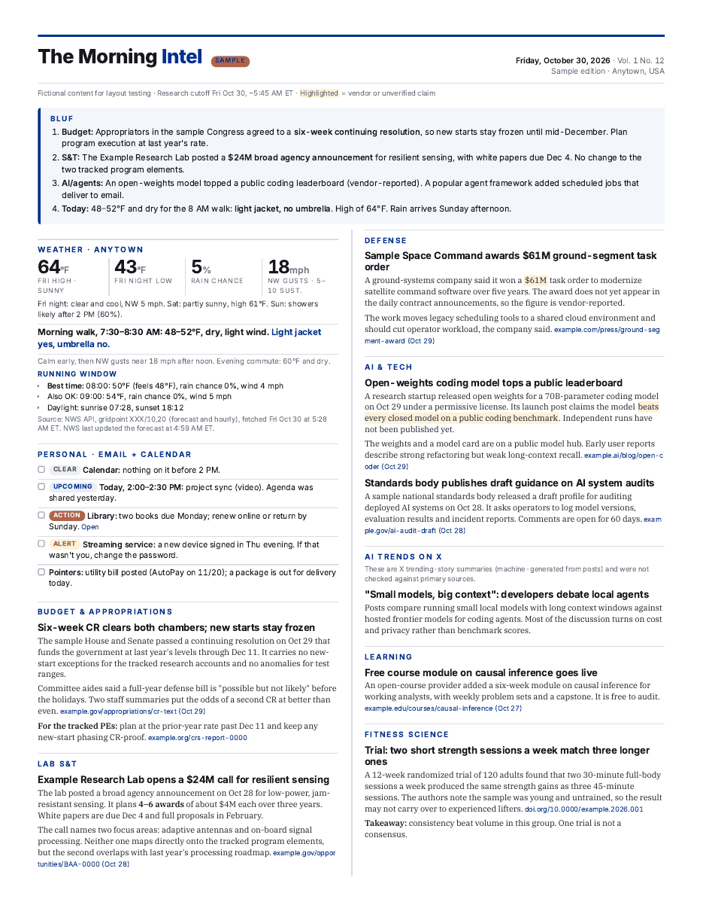

# lance-skills

Agent Skills I use with [Hermes Agent](https://github.com/NousResearch/hermes-agent).
Each folder is one skill in the open [Agent Skills](https://agentskills.io/specification)
layout: a `SKILL.md` with YAML frontmatter, plus optional `references/`, `templates/`,
`scripts/`, `assets/` and `examples/` folders.

| Skill | What it does |
|---|---|
| [`morning-intel`](skills/morning-intel/SKILL.md) | Researches the morning's news on your topics, checks it against primary sources, and lays it out as a 2-3 page two-column PDF newspaper, "The Morning Intel". Includes the template, render and QA scripts, an NWS weather helper, and a sourcing playbook. |



## Install in Hermes

Pick one. All commands are from the Hermes docs (links below).

```bash
# 1. From GitHub, by path (works with this repo layout)
hermes skills install lancewilhelm/lance-skills/skills/morning-intel

# 2. From a raw SKILL.md URL (copies SKILL.md plus every file it names under
#    references/, templates/, scripts/, assets/, examples/)
hermes skills install https://raw.githubusercontent.com/lancewilhelm/lance-skills/main/skills/morning-intel/SKILL.md

# 3. Local copy
mkdir -p ~/.hermes/skills/productivity
cp -r skills/morning-intel ~/.hermes/skills/productivity/
```

Or point Hermes at a checkout of this repo with `skills.external_dirs` in `~/.hermes/config.yaml`.

A tap (`hermes skills tap add lancewilhelm/lance-skills`) looks under `skills/` by default, which is where this repo keeps its skills.

New sessions see the skill as `/morning-intel`. In a running session use `/reset`.

## Set up morning-intel

1. Install the render tools: Chrome or Chromium, poppler-utils (`pdftoppm`, `pdfinfo`, `pdftotext`),
   Python 3.9+. Then run `skills/morning-intel/scripts/install_fonts.sh` (Inter, IBM Plex Serif, IBM Plex Mono).
2. Copy `skills/morning-intel/references/config.example.yaml` to `~/morning-intel/morning-intel.yaml` and fill it in.
3. Check the render: `python3 skills/morning-intel/scripts/render.py skills/morning-intel/examples/sample-issue.html --pdf ~/morning-intel/test.pdf`
   then `python3 skills/morning-intel/scripts/qa.py ~/morning-intel/test.pdf --html skills/morning-intel/examples/sample-issue.html` should print `PASS`.
4. Schedule it: see "Hermes: scheduling and delivery" in [`SKILL.md`](skills/morning-intel/SKILL.md). Short version:
   run the gateway as a service (`hermes gateway install`), set up the email gateway (`hermes gateway setup`),
   then create a weekday job with `--deliver email` and a weekend job with `--deliver origin`.

## Sources

- Agent Skills specification: https://agentskills.io/specification
- Hermes skills guide: https://github.com/NousResearch/hermes-agent/blob/main/website/docs/guides/work-with-skills.md
- Hermes CLI reference (`hermes skills install`, taps, `hermes cron`): https://github.com/NousResearch/hermes-agent/blob/main/website/docs/reference/cli-commands.md
- Creating skills (frontmatter, `metadata.hermes.config`, blueprints): https://github.com/NousResearch/hermes-agent/blob/main/website/docs/developer-guide/creating-skills.md
- Skill authoring standard (description ≤ 60 characters, author format, platforms): https://github.com/NousResearch/hermes-agent/blob/main/optional-skills/software-development/hermes-agent-skill-authoring/SKILL.md
- Cron jobs and delivery targets: https://github.com/NousResearch/hermes-agent/blob/main/website/docs/user-guide/features/cron.md
- Email gateway: https://github.com/NousResearch/hermes-agent/blob/main/website/docs/user-guide/messaging/email.md
- NWS API: https://www.weather.gov/documentation/services-web-api

Checked against Hermes Agent `main` at commit 6bb377a51 on 2026-10-30.

## License

Apache License 2.0. See [LICENSE](LICENSE).
